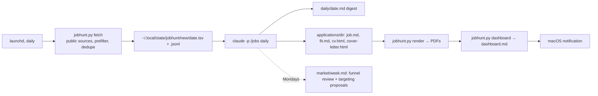

# jobhunt

A job-search assistant that runs on your Mac with [Claude Code](https://claude.com/claude-code). Every morning it:

1. pulls fresh listings from public job boards and company career pages,
2. scores each one against **your** criteria (stack, seniority, pay, location, hard-nos),
3. fully drafts the best 3–5 applications: a tailored CV and cover letter (as PDFs), plus fit notes with screening answers and the exact steps to apply,
4. drafts follow-up messages for applications that went quiet,
5. updates a pipeline dashboard and sends you a notification.

**It never applies, emails or messages anyone.** You review the drafts and send them yourself.

The drafts are only as good as what you tell it about yourself. The setup builds a **profile** where every claim is marked as evidenced or self-reported, and a **master CV** where every bullet records where it came from. The agent may only use what's in those files, so it can't invent a number or inflate your scope, and you can audit every line before sending.

## How it works



- `jobhunt.py`: stdlib-only Python. It fetches, prefilters, dedupes, renders PDFs and builds the dashboard. It never judges fit.
- `SKILL.md`: the `/jobs` Claude Code skill that does the judging and writing (`setup`, `daily`, `weekly`, `draft <url>`, `status`).
- `run-daily.sh` + `install.sh`: the daily schedule (launchd).
- `templates/`: what your hunt dir starts from, filled with an example persona.

Your data lives in a **hunt dir** that you choose, outside this repo. Nothing personal ever goes into the repo.

```
<hunt dir>/
  profile/profile.md     facts about you, each marked [E] evidenced or [I] self-reported, plus Corrections
  profile/stories.md     STAR stories for interviews and cover letters
  profile/voice.md       how you write, so letters sound like you
  cv-master.html         superset CV: every bullet carries data-src provenance
  criteria.md            goal, pay floor, role families, hard-nos, scoring rubric, CV rules, ready answers
  sources.toml           which boards/companies to fetch and the loose prefilter
  daily/                 one digest per day
  applications/<date>-<company>-<role>/   job.md (tracker entry), fit.md, cv.html/.pdf, cover-letter.html/.pdf
  market/                weekly reviews
  dashboard.md           generated KPIs, charts, what needs action
  Pipeline.base          Obsidian Kanban/table views (optional)
```

The tracker is the frontmatter of each `applications/*/job.md` (`status: drafted → sent → screen → interview → offer | rejected | ghosted | withdrawn | skipped`). Tell `/jobs` "sent Acme" or "rejected by X" and it updates it, or edit the file yourself, or drag cards in Obsidian.

## Sources

RemoteOK, Himalayas, We Work Remotely, Remotive, Working Nomads, Jobicy, Hacker News "Who is hiring", Habr Career (Russian-speaking market, off by default), and the public Greenhouse / Ashby / Lever job feeds of any companies you list. LinkedIn isn't included: its terms forbid scraping. To add a source, write a `src_*` function in `jobhunt.py`, with a test.

Respect each source's terms: RemoteOK and Remotive ask for attribution if you republish listings (this tool doesn't), and Remotive allows at most 4 fetches a day.

## Requirements

- macOS (the scheduler uses launchd; the rest is plain Python and would run elsewhere by hand)
- [Claude Code](https://claude.com/claude-code) logged in with a plan that covers daily use: one Opus session a day, plus one on Mondays. Check the cost against your plan
- Python ≥ 3.11 (`brew install python` or `mise use -g python@3.13`; macOS's built-in `python3` is too old)
- Google Chrome (renders the PDFs)
- Optional: [Obsidian](https://obsidian.md) for browsing the hunt dir, with the community plugin **Kanban Bases View** for the drag-and-drop board. Plain Markdown works too

## Get started

See **[SETUP.md](SETUP.md)**. In short: clone the repo, link it as a Claude Code skill, run `/jobs setup` and answer its questions (bring your CV), review what it wrote, try `/jobs draft <url>`, then `./install.sh`.

## Privacy

- Your profile, CVs and applications stay on your machine, in your hunt dir. Fetch state goes to `~/.local/state/jobhunt/`. Config goes to `~/.config/jobhunt/config.toml`.
- Content is sent to Anthropic only through Claude Code, the same as any session you run.
- Fetching sends plain GET requests to public job APIs. No accounts, no cookies.

## Development

```sh
python3 -B -m unittest discover -s .     # stdlib only, no installs
python3 jobhunt.py --help
```

## License

MIT, see [LICENSE](LICENSE).
